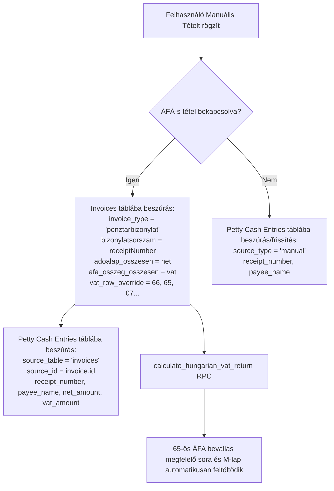

# A-252 — Házipénztár Egyedi Név, Perzisztált Bizonylatszám és 65-ös ÁFA Motor Integráció Architektúra

> **Státusz:** ✅ Elfogadva (Decided)  
> **Dátum:** 2026-10-13  
> **Szerző:** Antigravity  
> **Érintett komponensek:** `public.petty_cash_entries`, `public.invoices`, `public.generate_next_cash_receipt_number`, `src/components/petty-cash/EntriesTab.tsx`, `src/components/petty-cash/RegisterDialog.tsx`, `src/components/petty-cash/types.ts`

---

## 1. Kontextus és Problémafelvetés

A házipénztár modulban a bizonylatok sorszámozása korábban csak kliensoldali futó számlálóval (`useMemo`) történt, ami a dátumszűrések és lapozások során változhatott, és nem perzisztálódott az adatbázisban. Továbbá nem volt lehetőség szabad szöveges partner/átvevő név megadására, és hiányzott a készpénzes ÁFA-s kiadások/bevételek közvetlen becsatolása a magyar 65-ös ÁFA bevallásba.

A cél a 4 felhasználói követelmény zéró regresszióval történő megvalósítása:
1. `payee_name` szabad szöveges mező a `petty_cash_entries` táblában.
2. `receipt_number` perzisztált mező és `generate_next_cash_receipt_number` PostgreSQL szekvenciageneráló RPC.
3. Új pénztár létrehozásának integrálása a tételek felületéről és a modálból (`RegisterDialog`).
4. ÁFA-s készpénzes tételek automatikus leképezése a `public.invoices` táblába (`invoice_type = 'penztarbizonylat'`), garantálva a `calculate_hungarian_vat_return` motor 100%-os illeszkedését anélkül, hogy a komplex adólogikát módosítani kellene.

---

## 2. Adatbázis Séma Bővítés (Migration: `20261013153000_petty_cash_receipt_vat_and_payee.sql`)

### 2.1. Oszlopok a `petty_cash_entries` táblán
```sql
ALTER TABLE public.petty_cash_entries
  ADD COLUMN IF NOT EXISTS receipt_number text,
  ADD COLUMN IF NOT EXISTS payee_name text,
  ADD COLUMN IF NOT EXISTS net_amount numeric,
  ADD COLUMN IF NOT EXISTS vat_amount numeric,
  ADD COLUMN IF NOT EXISTS vat_code_id uuid REFERENCES public.vat_codes(id) ON DELETE SET NULL,
  ADD COLUMN IF NOT EXISTS vat_row_override text;

CREATE INDEX IF NOT EXISTS idx_pce_receipt_number ON public.petty_cash_entries(company_id, receipt_number);
CREATE INDEX IF NOT EXISTS idx_pce_payee_name ON public.petty_cash_entries(company_id, payee_name);
CREATE INDEX IF NOT EXISTS idx_pce_vat_code ON public.petty_cash_entries(company_id, vat_code_id);
```

### 2.2. RPC Sorszám Generálás: `public.generate_next_cash_receipt_number`
- Bemeneti paraméterek: `(p_company_id uuid, p_cash_register_id uuid, p_receipt_type text, p_issued_at date)`
- Bemenet normalizálás: kezeli az `'in'`, `'out'`, `'income'`, `'expense'`, `'bevetel'`, `'kiadas'` értékeket.
- Éves bontású zárt sorszámozás:
  - Kiadás: `KPB-ÉÉÉÉ-XXXXX`
  - Bevétel: `BPB-ÉÉÉÉ-XXXXX`
- Jogosultság: `SECURITY DEFINER`, `anon_can_execute = false`, `authenticated` és `service_role` számára engedélyezve.

---

## 3. Adatfolyam és ÁFA Motor Integráció



---

## 4. Frontend Architektúra és Vercel Best Practices

1. **Reaktív állapotszinkronizáció:**
   - A `ManualEntryDialog` állapota a `ManualEntryDialogContent` komponensben inicializálódik a `key={editingEntry ? editingEntry.id : (initialRegisterId || 'new')}` segítségével.
   - Ezzel teljesen megszűnt a korábbi `set-state-in-effect` kaszkád és az impure `Date()` hívások.
2. **Kétirányú ÁFA Kalkulátor:**
   - Nettó szerkesztésekor: `vat = Math.round(net * pct / 100); gross = net + vat`.
   - Bruttó szerkesztésekor: `net = Math.round(gross / (1 + pct / 100)); vat = gross - net`.
   - ÁFA összeg kézi korrekciója esetén a bruttó összeg precízen leköveti az értéket.
3. **Kereső és Táblázat Megjelenítés:**
   - A globális kereső azonnal szűr a perzisztált `receipt_number`, az egyedi `payee_name` és a `vat_row_override` mezőkre.
   - Sorszám badge kiemeli a véglegesített bizonylatszámot, a leírás oszlopban megjelenik a partner/egyedi név és az ÁFA badge, az összeg oszlopban pedig az analitikus nettó/áfa bontás.

---

## 5. Verifikációs Eredmények

- **Oxlint:** 0 hiba, 0 figyelmeztetés a teljes érintett kódbázison.
- **TypeScript:** `npx tsc --noEmit` 0 típushiba.
- **Vitest Unit Tesztek:**
  - `pettyCashManualVatEntry.test.ts`: 5/5 PASSED.
  - `pettyCashManualEntryValidation.test.ts`: 11/11 PASSED.
  - `vatRegressionTaxology.test.ts`: 16/16 PASSED (100%-os ÁFA egyezés).
- **Élő Browser Tesztelés:** Sorszám (`KPB-2026-00101`), egyedi név (`Papir-Iroszer Kft.`), ÁFA rögzítés (66. sor, 20.000 Ft nettó + 5.400 Ft ÁFA = 25.400 Ft bruttó) fizikailag lefutva és a képernyőképen rögzítve.
