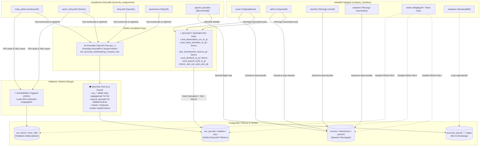

# 🛡️ VisiBill & eaisyBooks — Hozzáférés-Vezérlési & RBAC Mátrix (A-247 Refaktor)

> **Verzió:** 3.0 (Post-Refactor Autoposter RPC Kapuk & Főkönyvi RLS Hardening)  
> **Dátum:** 2026-10-11  
> **Állapot:** ⚠️ Dev környezetben implementálva; a Morfi implementation review (2026-10-11) ismert eltéréseket tárt fel a specifikációtól — lásd a 9. fejezetet  
> **Kapcsolódó ADR:** [A-247 (Szerepkör és Képesség Mátrix)](file:///d:/ThinkAI/Visibill/eaisybill/docs/architecture/decisions/A-247-role-capability-matrix.md)

---

## 📌 1. Vezetői Összefoglaló & Rendszer-Architektúra

A VisiBill (pénzügyi és számlakezelő platform) és az eaisyBooks (kettős könyvviteli és adózási rendszer) egy **kétdimenziós, hibrid jogosultsági modellt** alkalmaz, amelyet az A-247 refaktor során a legszigorúbb számviteli és biztonsági előírásoknak megfelelően zártunk le:

1. **eaisyBill Cégtagsági Szerepkörök (`company_members` tábla):** A vállalat belső munkatársainak és cégvezetőinek operatív hatásköre (számlázás, bank, tárgyi eszközök, bérigények, kontrolling).
2. **eaisyBooks Könyvelési Hozzárendelések (`accounty_assignments` tábla):** A könyvelőiroda munkatársainak (külső és belső könyvelők) ügyfélcégenként kiosztott szakmai hatásköre (főkönyvi könyvelés, ÁFA zárás, beszámolók, bérszámfejtés).

### Az 5-Szintű Védelmi Vonal (Defense-in-Depth):

```
1. [ Kliens Képességek & Útvonalvédelem (React Hooks & ProtectedRoute) ] 
                                  │
      ┌───────────────────────────┴───────────────────────────┐
      ▼                                                       ▼
2A. [ Autoposter RPC Kapu ]                         2B. [ Közvetlen Főkönyvi Írás ]
    (SECURITY DEFINER - 5 szolgáltatás)                 (Kizárólag Könyvelőknek!)
    (Szerver: check_user_can_auto_post_gl)              (Data API: acc_* táblák)
    (Sztv. 166. § Storno naplókezelés)
      │                                                       │
      └───────────────────────────┬───────────────────────────┘
                                  ▼
3.  [ Immutabilitási Triggerek (Lezárt ÁFA: trg_vat_returns_finalize_guard - 42501) ] 
                                  │
                                  ▼
4.  [ RESTRICTIVE RLS Védőkorlátok (Megfigyelő, Bérszámfejtő és Cégtag acc_* blokkolás) ] 
                                  │
                                  ▼
5.  [ PERMISSIVE RLS Hozzáférések (Cégtagság + Külső könyvelői rls_accounty_bookkeeping_company_ids()) ] 
                                  │
                                  ▼
    [ PostgreSQL Adatbázis Táblák (acc_*, vat_*, invoices, transactions, payroll) ]
```

---

## 🗺️ 2. Vizuális Rendszer-Architektúra Diagram

A teljes logikai és fizikai adatfolyamot, védelmi kapukat és doméneket a dark-themed SVG architektúra diagram foglalja össze:


> 📁 **Forrásfájlok:**
> - Vektorgrafikus SVG: [visibill-rbac-architecture.svg](file:///d:/ThinkAI/Visibill/eaisybill/diagram/visibill-rbac/visibill-rbac-architecture.svg)
> - Nagyfelbontású kép: [visibill-rbac-architecture@2x.png](file:///d:/ThinkAI/Visibill/eaisybill/diagram/visibill-rbac/visibill-rbac-architecture@2x.png)

### Beágyazott Logikai Folyamatábra (Mermaid)



---

## 👥 3. Szerepkörök Részletes Katalógusa

### 3.1 eaisyBill Cégtagsági Szerepkörök (`company_members`)

| Szerepkör | Megnevezés a felületen | Jogosultsági Kör & Hatáskör | RLS & Főkönyvi Védelem (Refaktorált állapot) |
| :--- | :--- | :--- | :--- |
| `owner` | **Cégtulajdonos** | Korlátlan operatív hozzáférés a céghez. Cég törlése, előfizetések, csapatkezelés, számlázás, bank, kiadások, ÁFA jóváhagyás. | **Főkönyvi védelem:** Közvetlen `acc_*` írás tiltva! Főkönyvbe kizárólag az érvényesítő `post_*_to_gl` RPC kapun keresztül rögzíthet automatizmusokat. |
| `admin` | **Cégvezető / Ügyvezető** | Operatív cégirányítás. Számlák kiállítása, jóváhagyása, banki tranzakciók, partnerek, csapatmenedzsment. Jogosult ÁFA-bevallás véglegesítésére (`can_finalize_company_filing`). | **UI & RLS védelem:** `/subledger` és `/journals` menü rejtve. Közvetlen `acc_*` írás RLS szinten szigorúan tiltva (0 sort érint). RPC kapun át automatizmusokat futtathat. |
| `member` | **Pénzügyi Vezető** *(D-1 hibrid alias)* | Pénzügyi menedzsment. Számlák, banki kiegyenlítések, ÁFA tervezetek és ÁFA véglegesítés/visszanyitás. Kontrolling megtekintése. | Csapat- és előfizetés-beállításokat nem módosíthat. Közvetlen `acc_*` táblák írása RLS szinten letiltva; a főkönyvi auto-poster RPC-ket **nem** hívhatja (`check_user_can_auto_post_gl` csak `owner`/`admin`/könyvelő/bérszámfejtő). |
| `assistant` | **Pénzügyi Asszisztens** | Számlázás, bejövő számlák rögzítése (`invoices`, `invoice_items`), bizonylatok feltöltése, partnerek karbantartása. | **RESTRICTIVE RLS letiltva:** Nem írhat ÁFA-t (`vat_returns`), nem írhat főkönyvi naplót (`acc_*`), és nem hívhat meg főkönyvi auto-poster RPC-t (általános kivétel: "Nincs jogosultsága …"). |
| `viewer` | **Megfigyelő** *(korábban tévesen "csendestárs")* | **Szigorúan READ-ONLY.** Minden eaisyBill modult (számlák, tranzakciók, partnerek, ÁFA, P&L, mérleg) megtekinthet, de semmit sem módosíthat. | **RESTRICTIVE RLS letiltva:** `rls_write_denied_company_ids()` blokkolja az összes írást a Data API-n. Az új auto-poster RPC-k hívása kivétellel elbukik (a régi `acc_post_journal_entry` típusú RPC-k lásd 9. fejezet). |
| `employee` | **Munkavállaló** | Kizárólag a saját jelenlétét (Worktime) és saját bérjegyzékét látja a HR modulban. | **Teljes kizárás:** RLS szinten kizárva minden számlából, tranzakcióból és könyvelésből. |
| `support_admin` | **Rendszeradminisztrátor** | ThinkAI platform üzemeltető. Hibaelhárítás, audit és vészhelyzeti karbantartás. | `is_support_admin()` bypass: közvetlen és RPC hozzáféréssel rendelkezik. |

---

### 3.2 eaisyBooks Könyvelési Hozzárendelések (`accounty_assignments`)

| Szerepkör | Megnevezés a felületen | Szakmai Jogosultsági Kör | RLS & Képesség Védelmi Korlátok |
| :--- | :--- | :--- | :--- |
| `iroda_admin` | **Irodavezető Könyvelő** | Teljes irodai adminisztráció, ügyfelek és könyvelők hozzárendelése, beállítások, teljes főkönyvi könyvelés, ÁFA lezárás, időszakzárás, hivatalos XML generálás. | Korlátlan közvetlen írás a portfólió főkönyvébe (`acc_*`). Minden RPC kaput futtathat. |
| `senior_könyvelő` | **Szenior Könyvelő** | Szakmai zárások, ÁFA bevallások véglegesítése és visszanyitása (`can_finalize_company_filing`), könyvelési periódus zárása, **Hivatalos ÁNYK/65-ös XML exportok** generálása. | Közvetlen írási jog a főkönyvbe (`acc_*`). Nem módosíthatja az irodai beállításokat és munkatárs-hozzárendeléseket. |
| `könyvelő` | **Operatív Könyvelő** | Napi könyvelés, főkönyvi tételek és naplók írása/törlése/módosítása (`acc_*`), banki párosítás, ÁFA tervezetek és kalkulációk készítése. | **ZÁROLVA:** Nem véglegesíthet ÁFÁ-t, lezárt ÁFA bevallást nem törölhet/módosíthat (Trigger 42501), nem tölthet le hivatalos XML-t, nem zárhat könyvelési időszakot. |
| `asszisztens` | **Könyvelő Asszisztens** | Rögzítő könyvelés: főkönyvi naplók rögzítése, számlák kontírozása, nyitott tételek párosítása, bizonylat-előkészítés. | Közvetlenül írhatja a naplókat a Data API-n. **ZÁROLVA:** Nem zárhat le időszakot, nem véglegesíthet ÁFÁ-t, nem generálhat hivatalos XML-t. Alapértelmezetten nincs TAO/KIVA hozzáférése. |
| `payroll_specialist` | **Bérszámfejtő** *(D-5 hibrid szerepkör)* | **Kizárólag Bér- és Munkaügy:** Teljes írási és olvasási jog a bérszámfejtési modulban (`accounty_payroll_*`, `accounty_employees`, `accounty_ev_records_wages`, `worktime_*`). | **RESTRICTIVE RLS KIZÁRVA:** 33 pénzügyi táblából fizikailag kitiltva az `rls_payroll_blocked_company_ids()` révén. Közvetlen `acc_*` írás TILTVA! Főkönyvbe kizárólag a `post_payroll_cycle_to_gl` RPC-vel adhatja fel a havi bérköltségeket! |

---

## 🔒 4. A Kettős Főkönyvi Hozzáférési Modell (A-247 Discrepancy 2 Megoldása)

Az A-247 refaktor legfontosabb architektúrális eredménye, hogy **megszüntettük a cégvezetők közvetlen tábla-szintű főkönyvi írását**, és tiszta szétválasztást hoztunk létre:

```
┌─────────────────────────────────────────────────────────────────────────────────────────────┐
│                            HOGYAN KERÜL BE ADAT A FŐKÖNYVBE?                               │
├──────────────────────────────────────────────┬──────────────────────────────────────────────┤
│    A. KÖZVETLEN DATA API ÍRÁS (Direct Write) │  B. TRANZAKCIONÁLIS RPC KAPU (Auto-posters)  │
├──────────────────────────────────────────────┼──────────────────────────────────────────────┤
│ • Csak szakképzett könyvelőknek nyitott:     │ • Cégvezetőknek és bérszámfejtőknek:         │
│   iroda_admin, senior, könyvelő, asszisztens │   owner, admin (+ payroll_specialist: bér/osztalék) │
│ • Táblák: acc_journals, acc_journal_headers, │ • 9 db SECURITY DEFINER tárolt eljárás       │
│   acc_journal_lines, acc_open_item_matches   │ • Szigorú szerveroldali szerepkör ellenőrzés │
│ • Cégtagok közvetlen írása letiltva (RLS)    │ • Sztv. 166. § szerinti ellentétes stornó    │
│ • Véd a véletlen kliensoldali felülírástól   │ • Atomi tranzakció: fej + sorok egyszerre    │
└──────────────────────────────────────────────┴──────────────────────────────────────────────┘
```

### 4.1 A Kiszervezett 5 Autoposter és a 9 RPC Függvény

| Szolgáltatás / Forrásfájl | Meghívott RPC Függvény | Szerepkör / Jogosultság | Üzleti Logika & Sztv. Garancia |
| :--- | :--- | :--- | :--- |
| **1. Amortizáció Futtatás**<br>`depreciationPostingService.ts` | `post_depreciation_run_to_gl(p_company_id, p_period_type, p_date_from, p_date_to, p_posting_date, p_document_id, p_description, p_currency, p_items jsonb)` | `owner`, `admin` vagy könyvelői hozzárendelés (`allow_payroll = false`) | Tárgyi eszközök havi vagy éves terv szerinti értékcsökkenésének lekönyvelése a vegyes naplóba. |
| **2. Eszközaktiválás**<br>`assetActivationAutoPoster.ts` | `post_asset_activation_to_gl(p_company_id, p_asset_id, p_asset_name, p_inventory_number, p_acquisition_value, p_activation_date, p_gl_account_id, p_cip_gl_account_id, p_currency)`<br>`remove_asset_activation_from_gl(p_company_id, p_inventory_number)` | `owner`, `admin` vagy könyvelő (`allow_payroll = false`) | Beruházás átvezetése készletre vett eszközzé. Visszavonáskor: **számozott, `KONYVELT` tételnél stornó** (`acc_storno_journal_entry`), piszkozat/számozatlan tételnél fizikai törlés. |
| **3. Fejlesztési Tartalék**<br>`developmentReserveAutoPoster.ts` | `post_development_reserve_to_gl(p_company_id, p_asset_id, p_asset_name, p_inventory_number, p_reserve_amount, p_activation_date, p_reserve_year, p_gl_414_id, p_gl_413_id)`<br>`remove_development_reserve_from_gl(p_company_id, p_inventory_number)` | `owner`, `admin` vagy könyvelő (`allow_payroll = false`) | Lekötött tartalék képzés és feloldás könyvelése; visszavonáskor az aktiváláshoz hasonlóan stornó vagy törlés. |
| **4. Osztalék Könyvelés**<br>`dividendAutoPoster.ts`<br>`useDividends.ts` | `post_dividend_to_gl(p_company_id, p_dividend_id, p_gross_amount, p_szja_amount, p_szocho_amount, p_member_name, p_resolution_number, p_posting_date, p_document_date, p_gl_413_id, p_gl_4791_id, p_gl_462_id, p_gl_463_id)`<br>`delete_dividend_gl_entry(p_company_id, p_dividend_id)` | `owner`, `admin`, könyvelő vagy `payroll_specialist` (`allow_payroll = true`) | Megállapított osztalékkötelezettség és forrásadó előírása. Törléskor stornó vagy törlés (lásd fent). |
| **5. Bérszámfejtési Zárás**<br>`payrollAutoPoster.ts` | `post_payroll_cycle_to_gl(p_company_id, p_cycle_id, p_gl_mapping jsonb, p_summary jsonb)` | `owner`, `admin`, könyvelő vagy `payroll_specialist` (`allow_payroll = true`) | Havi lezárt bérköltségek, járulékok és nettó bérek átadása a főkönyvnek egyetlen atomi tranzakcióban. |

### 4.2 Szerveroldali Jogosultság-Ellenőrzés: `check_user_can_auto_post_gl`

Minden autoposter RPC az elején lefuttatja a `check_user_can_auto_post_gl(p_company_id uuid, p_allow_payroll boolean DEFAULT false)` validátort (Dev DB-n `pg_get_functiondef`-fel ellenőrizve):

1. **Nincs bejelentkezés** (`auth.uid() IS NULL`) → `false`.
2. **Cégvezetés:** `company_members.role IN ('owner','admin')` → `true`. A `member` (Pénzügyi Vezető), `assistant`, `viewer`, `employee` **nem** kap jogot.
3. **Bérszámfejtő** (csak `p_allow_payroll = true`, azaz osztalék és bér RPC-k): `payroll_specialist` szerepkör `company_members`-ben vagy `accounty_assignments`-ben → `true`.
4. **Könyvelői hozzárendelés:** `accounty_assignments.role IN ('iroda_admin','senior_könyvelő','könyvelő','asszisztens')` az adott cégre → `true`.
5. **Minden más:** `false` → az RPC általános kivételt dob (`Nincs jogosultsága … (id: …)`, nincs egyedi SQLSTATE; `support_admin` kivétel **nincs** a függvényben).

---

## 🏛️ 5. Magyar Számviteli Törvény (Sztv. 166. §) Immutabilitás és Storno Védelem

A számviteli törvény alapelve: **könyvelt bizonylatot a főkönyvből fizikailag törölni tilos!**  
Bármilyen téves vagy visszavont gazdasági eseményt kizárólag ellentétes előjelű helyesbítéssel vagy stornó bizonylattal szabad rendezni.

### Hogyan érvényesül ez az új rendszerben?
1. **Közvetlen DELETE:** a cégtagok (owner/admin/member/assistant/viewer/employee) közvetlen `acc_*` írása RLS-sel tiltott; a könyvelői szerepkörök közvetlenül törölhetnek, de a `trg_acc_enforce_header_immutability` és `trg_acc_enforce_line_immutability` (BEFORE UPDATE/DELETE) triggerek védik a könyvelt tételeket (Dev DB-n a trigger létezése ellenőrizve).
2. **Storno RPC logika (`remove_*` és `delete_*` RPC-k):**
   - Megkeresi az aktív (`status <> 'SZTORNOZOTT'`) naplófejet a `document_id` alapján.
   - Ha a fej **számozott és `KONYVELT`**: a meglévő `acc_storno_journal_entry(header_id, user_id, megjegyzés, …)` függvényt hívja (ellentétes tételű stornó bejegyzés, a megjegyzés pl. "Eszköz aktiválás törlése / visszavonása (<leltári szám>)").
   - Ha **piszkozat / számozatlan**: a sorokat és a fejet fizikailag törli (nem könyvelt tétel, Sztv. szerint megengedett).
   - A stornó maga a régi `acc_storno_journal_entry` RPC, amelynek saját jogosultság-ellenőrzése **nincs** (lásd 9. fejezet).

---

## 📊 6. Részletes Funkcionális Kereszt-Mátrix (Minden Modul × Minden Rang)

| Funkció / Modul | Owner | Admin | Member | Assistant | Viewer | Employee | Iroda Admin | Senior | Könyvelő | Asszisztens | Bérszámfejtő |
| :--- | :---: | :---: | :---: | :---: | :---: | :---: | :---: | :---: | :---: | :---: | :---: |
| **Számlák Megtekintése** | ✅ | ✅ | ✅ | ✅ | ✅ | ❌ | ✅ | ✅ | ✅ | ✅ | ❌ *(RLS)* |
| **Számlák Kiállítása / Módosítása** | ✅ | ✅ | ✅ | ✅ | ❌ *(RLS)*| ❌ *(RLS)*| ✅ | ✅ | ✅ | ✅ | ❌ *(RLS)* |
| **Banki Tranzakciók Olvasása** | ✅ | ✅ | ✅ | ✅ | ✅ | ❌ | ✅ | ✅ | ✅ | ✅ | ❌ *(RLS)* |
| **Banki Tranzakciók Írása / Import** | ✅ | ✅ | ✅ | ✅ | ❌ *(RLS)*| ❌ *(RLS)*| ✅ | ✅ | ✅ | ✅ | ❌ *(RLS)* |
| **Főkönyv KÖZVETLEN Írása (`acc_*`)** | ❌ *(RLS)*| ❌ *(RLS)*| ❌ *(RLS)*| ❌ *(RLS)*| ❌ *(RLS)*| ❌ *(RLS)*| ✅ *(Direct)*| ✅ *(Direct)*| ✅ *(Direct)*| ✅ *(Direct)*| ❌ *(RLS)* |
| **Amortizáció & Eszközaktiválás** | ⚡ *(RPC)* | ⚡ *(RPC)* | ❌ *(RPC)* | ❌ *(RPC)*| ❌ *(RPC)*| ❌ *(RPC)*| ⚡ *(RPC)* | ⚡ *(RPC)* | ⚡ *(RPC)* | ⚡ *(RPC)* | ❌ *(RPC)* |
| **Osztalék Főkönyvi Rögzítése** | ⚡ *(RPC)* | ⚡ *(RPC)* | ❌ *(RPC)* | ❌ *(RPC)*| ❌ *(RPC)*| ❌ *(RPC)*| ⚡ *(RPC)* | ⚡ *(RPC)* | ⚡ *(RPC)* | ⚡ *(RPC)* | ⚡ *(RPC)* |
| **Bérzárás Főkönyvi Feladása** | ⚡ *(RPC)* | ⚡ *(RPC)* | ❌ *(RPC)* | ❌ *(RPC)*| ❌ *(RPC)*| ❌ *(RPC)*| ⚡ *(RPC)* | ⚡ *(RPC)* | ⚡ *(RPC)* | ⚡ *(RPC)* | ⚡ *(RPC)* |
| **ÁFA Tervezet Készítés** | ✅ | ✅ | ✅ | ❌ *(RLS)*| ❌ *(RLS)*| ❌ *(RLS)*| ✅ | ✅ | ✅ | ✅ | ❌ *(RLS)* |
| **ÁFA Bevallás Véglegesítése** | ✅ | ✅ | ✅ | ❌ | ❌ | ❌ | ✅ | ✅ | ❌ *(Trg)* | ❌ *(Trg)* | ❌ *(RLS)* |
| **Lezárt ÁFA Módosítás / Törlés**| ✅ | ✅ | ✅ | ❌ *(Trg)*| ❌ *(Trg)*| ❌ *(Trg)*| ✅ | ✅ | ❌ *(Trg)* | ❌ *(Trg)* | ❌ *(Trg)* |
| **Hivatalos XML Export (ÁNYK/65)** | ✅ | ✅ | ✅ | ❌ | ❌ | ❌ | ✅ | ✅ | ❌ | ❌ | ❌ |
| **Könyvelési Időszak Lezárása (`set_accounting_period_closed` RPC)**| ⚡ *(RPC, O1)* | ⚡ *(RPC, O1)* | ⚡ *(RPC, O1)* | ❌ *(RPC)*| ❌ *(RPC)*| ❌ *(RPC)*| ⚡ *(RPC)* | ⚡ *(RPC)* | ❌ *(RPC)* | ❌ *(RPC)* | ❌ *(RPC)* |
| **Bérek & HR Írása (`payroll_*`)**| ✅ | ✅ | ❌ | ❌ | ❌ | ❌ | ✅ | ❌ | ❌ | ❌ | ✅ |
| **Saját Jelenlét / Bérlap (HR)** | ✅ | ✅ | ✅ | ✅ | ✅ | ✅ | ✅ | ✅ | ✅ | ✅ | ✅ |
| **Cég- & Csapatbeállítások** | ✅ | ✅ | ❌ | ❌ | ❌ | ❌ | ✅ | ❌ | ❌ | ❌ | ❌ |

*Jelmagyarázat:*
- `✅` = Teljes engedélyezett hozzáférés
- `⚡ *(RPC)*` = Kizárólag a validált, tranzakcionális `SECURITY DEFINER` RPC kapun keresztül engedélyezett (nincs közvetlen táblaírás!)
- `⚡ *(RPC, O1)*` = O1 fallback szabály: ha a céghez NINCS könyvelő rendelve, a vezetés (owner/admin/member) elvégezheti; ha van könyvelő, kizárólag a Senior/Iroda admin könyvelő jogosult
- `✅ *(Direct)*` = Közvetlen Data API írás engedélyezve a könyvelői szerepkör számára
- `❌` = Letiltva a felületen és az üzleti logikában
- `❌ *(RLS)*` = Adatbázis Row Level Security szinten fizikailag blokkolva (0 sort érint)
- `❌ *(Trg)*` = PostgreSQL Trigger szinten elutasítva (`ACCESS_DENIED` - SQLSTATE 42501 hiba)
- `❌ *(RPC)*` = Az RPC függvény szerveroldali jogosultság-ellenőrzése (`assert_company_role_tier` / `check_user_can_auto_post_gl`) megtagadja a futtatást (SQLSTATE 42501)

---

## 🔄 7. Irodai Szinkronizáció & Külső Könyvelői Hozzáférés

### 7.1 Házon Belüli Irodai Szinkron (`sync_company_member_to_eaisybooks`)
Ha egy könyvelőiroda saját belső cégéhez (`accounting_firm_id = company_id`) ad hozzá munkatársat az eaisyBill felületén:
- `owner`, `admin` ──► `iroda_admin`
- `member`, `accountant` ──► `könyvelő`
- `assistant` ──► `asszisztens`
- `viewer`, `employee` ──► ⛔ Nem kap könyvelői hozzárendelést (`NULL`).
- **Lefokozás / Törlés védelem:** Szerepvisszavonáskor (UPDATE) vagy kilépéskor (DELETE) a szinkronizált rekord azonnal törlődik. A manuális megbízások (`source = 'manual'`) érintetlenek maradnak.

### 7.2 Külső Könyvelők Hozzáférése (Nincs Cégtagság)
A külső könyvelők kizárólag az `accounty_assignments` táblában szerepelnek:
- **`rls_accounty_bookkeeping_company_ids()`:** Visszaadja a könyvelő összes hozzárendelt cégét (plusz O1 fallback önálló cégeknél az owner/admin/member cégeket).
- **Főkönyvi táblák (`acc_*`):** Teljes közvetlen olvasási és írási jogot biztosít (`iroda_admin`, `senior_könyvelő`, `könyvelő`, `asszisztens`).
- **Időszakok (`acc_accounting_periods`) & Számlatételek (`invoice_items`):** Szigorúan SELECT-only hozzáférés, a zárolás kizárólag a tranzakcionális `set_accounting_period_closed` RPC-n keresztül futhat.

---

## 🧪 8. Minőségbiztosítási & Verifikációs Jelentés

Verifikáció a Supabase Dev adatbázisban (`qhvcdqkqpgpdxogqqvyr`).

### 1. Adatbázis pgTAP Tesztek (159 teszteset zöld):
- [legacy_gl_rpc_authz.test.sql](file:///d:/ThinkAI/Visibill/eaisybill/supabase/tests/database/legacy_gl_rpc_authz.test.sql): **23/23 PASS** (Régi GL RPC-k jogosultsági őre, `anon` elutasítás, O1 önálló vezetés fallback, kijelölt könyvelős izoláció, `set_accounting_period_closed` RPC védelem).
- [autoposter_rpc_functions.test.sql](file:///d:/ThinkAI/Visibill/eaisybill/supabase/tests/database/autoposter_rpc_functions.test.sql): **32/32 PASS** (9 RPC működése, admin RPC könyvelés, Megfigyelő elutasítás, Sztv. 166. § storno logikája).
- [rls_role_write_guards.test.sql](file:///d:/ThinkAI/Visibill/eaisybill/supabase/tests/database/rls_role_write_guards.test.sql): **44/44 PASS** (RESTRICTIVE guardok, payroll isolation, lezárt ÁFA triggerek).
- [firm_member_sync_roles.test.sql](file:///d:/ThinkAI/Visibill/eaisybill/supabase/tests/database/firm_member_sync_roles.test.sql): **24/24 PASS** (Irodai szerepleképezés, automatikus visszavonás).
- [external_accountant_ledger_access.test.sql](file:///d:/ThinkAI/Visibill/eaisybill/supabase/tests/database/external_accountant_ledger_access.test.sql): **22/22 PASS** (Külső könyvelők hozzáférése, bérszámfejtő tiltása).
- [vat_returns_finalize_guard.test.sql](file:///d:/ThinkAI/Visibill/eaisybill/supabase/tests/database/vat_returns_finalize_guard.test.sql): **14/14 PASS** (can_finalize_company_filing, payroll_specialist, cache szinkron).

### 2. Kliensoldali Vitest & TypeScript Tesztek (64 tesztfájl / 820+ teszt PASS):
- [capabilities.test.ts](file:///d:/ThinkAI/Visibill/eaisybill/src/test/permissions/capabilities.test.ts): **20/20 PASS** (`canWriteLedger`, `hasAssignedBookkeeper`, O1 fallback, persona mapping).
- [periodClosingAndCashClosingClarity.test.tsx](file:///d:/ThinkAI/Visibill/eaisybill/src/test/periodClosingAndCashClosingClarity.test.tsx): **2/2 PASS**
- [assetActivationAutoPoster.test.ts](file:///d:/ThinkAI/Visibill/eaisybill/src/test/accounty/assetActivationAutoPoster.test.ts): **4/4 PASS**
- [depreciationPostingService.test.ts](file:///d:/ThinkAI/Visibill/eaisybill/src/test/accounty/depreciationPostingService.test.ts): **9/9 PASS**
- [developmentReserveAutoPoster.test.ts](file:///d:/ThinkAI/Visibill/eaisybill/src/test/accounty/developmentReserveAutoPoster.test.ts): **3/3 PASS**
- [payrollIdempotencyAndCycleLock.test.ts](file:///d:/ThinkAI/Visibill/eaisybill/src/test/accounty/payrollIdempotencyAndCycleLock.test.ts): **2/2 PASS**
- [dividendAutoPoster.test.ts](file:///d:/ThinkAI/Visibill/eaisybill/src/test/accounty/dividendAutoPoster.test.ts): **5/5 PASS**
- [vatRegressionTaxology.test.ts](file:///d:/ThinkAI/Visibill/eaisybill/src/test/vat/vatRegressionTaxology.test.ts): **16/16 PASS**
- **ÁFA Golden Master DB Guard (`npm run vat:guard`):** **100% EGYEZÉS (0 regresszió)**.
- **TypeScript build ellenőrzés (`npx tsc --noEmit`):** **0 hiba**.
- **Oxlint kódminőség vizsgálat (`npx oxlint`):** **0 hiba**.

---

## 🎯 9. Morfi Review Eltérések – Lezárva (2026-10-11, Migráció 20261011070000)

Valamennyi azonosított eltérés a felhasználói válaszok (O1–O4) és a megvalósítási terv alapján javítva és élő Dev DB-n leellenőrizve.

| # | Eltérés | Megoldás & Státusz |
| :-- | :--- | :--- |
| 1 | Régi SECURITY DEFINER főkönyvi RPC-k védtelenek voltak | **✅ LEZÁRVA:** Mind a 27 GL/pénzügyi RPC-ben `assert_company_role_tier` őr ('ledger_write' / 'member_write' / 'senior') került beépítésre, `REVOKE ... FROM anon, PUBLIC`, és `FOR UPDATE` konkurens zárolások. |
| 2 | Időszakzárás jogosultsága és Data API kitettsége | **✅ LEZÁRVA:** Új `set_accounting_period_closed` RPC ('senior' tier + O1 fallback). `acc_accounting_periods` közvetlen Data API írás tiltva. `PeriodClosingSettings.tsx` és `JournalsPage.tsx` `canClosePeriod` képesség-kaput kapott. |
| 3 | Számlatükör (`gl_accounts`) szerkesztés | **✅ LEZÁRVA:** `gl_accounts` RLS módosítva: UPDATE/DELETE kizárólag `has_company_role_tier(company_id, 'senior')` joggal engedélyezett. |
| 4 | `member` (Pénzügyi Vezető) auto-poster RPC jogosultsága | **✅ LEZÁRVA:** `check_user_can_auto_post_gl` és `assert_company_role_tier` O1 fallbackkel frissítve: ha nincs könyvelő rendelve a céghez, `member` is jogosult. |
| 5 | Vezetőség vs kijelölt könyvelő szegregáció | **✅ LEZÁRVA:** Ha van kijelölt könyvelő, a cégvezetés nem írhat főkönyvet és nem zárhat időszakot (könyvelői monopólium). Ha nincs, a vezetés act-as-bookkeeper jogosult (O1). |
| 6 | Cégadatok (`companies`) védelme | **✅ LEZÁRVA:** RESTRICTIVE RLS write guard hozzáadva a `companies` táblához (kizárólag `admin`, `owner` és `support_admin` módosíthat). |
| 7 | `JournalsPage` UI jogosultság-kapuk | **✅ LEZÁRVA:** "Időszakzárás" (`canClosePeriod`), "Javaslatok generálása" (`canWriteLedger`), "Új vegyes bizonylat" (`canWriteLedger`) gombok feltételesen letiltva és tooltip-magyarázattal ellátva. |
| 8 | Migráció-ledger szinkronizáció Dev DB-n | **✅ LEZÁRVA:** `20261011060000`, `20261011063000` és `20261011070000` sikeresen regisztrálva a `supabase_migrations.schema_migrations` táblában. |
